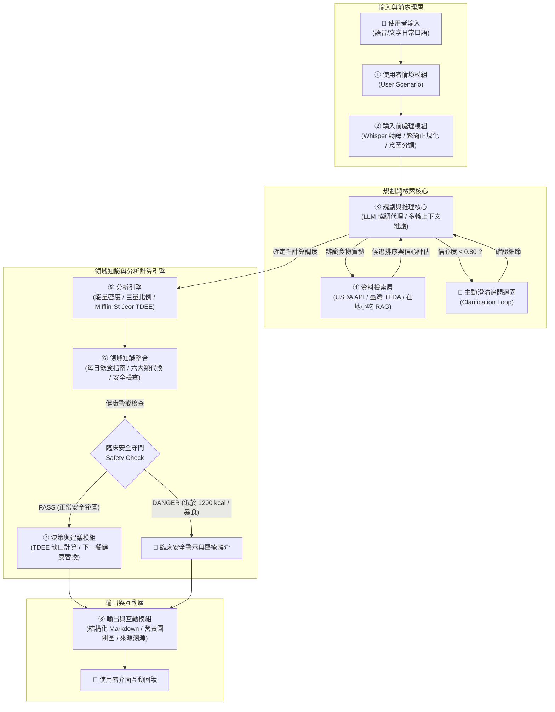
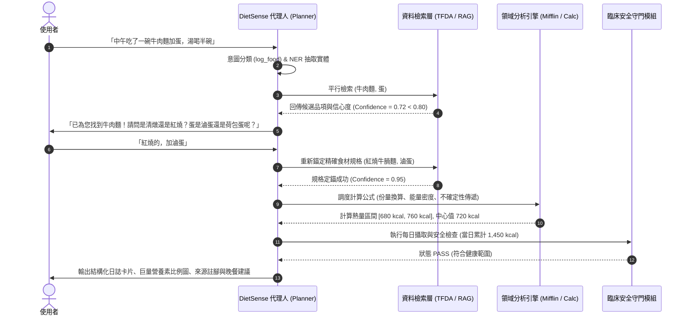
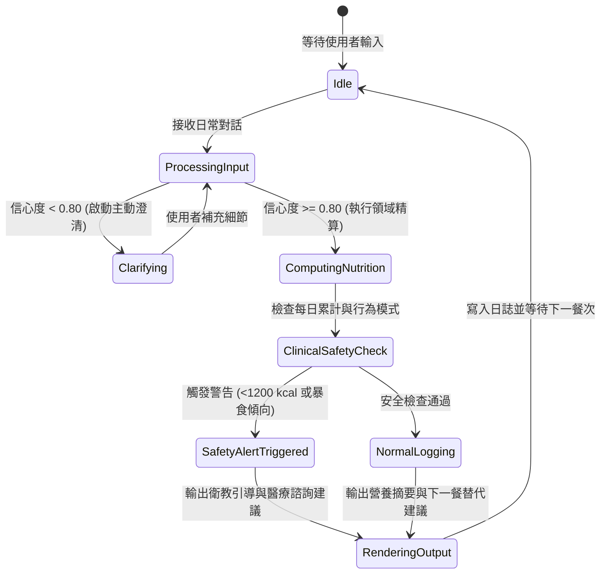

# DietSense 系統設計藍圖 (System Design Blueprint)

> **專案全稱**：DIC3-Project Proposal Refactor using Openspec: DietSense  
> **系統定位**：對話式日常熱量攝取分析 Domain AI Agent (Conversational Calorie & Nutrition Intake Domain AI Agent)  
> **規範標準**：Openspec Spec-Driven Development (SDD) & A2Z 論文架構藍圖  
> **作者與維護**：DIC3 專案團隊

---

## 目錄

- [一、Part 2：專案 A 至 F 核心（A–F Cores）](#一部分-2專案-a-至-f-核心af-cores)
  - [A. Attention Getter（動機與引題）](#a-attention-getter動機與引題)
  - [B. But（挑戰與 Research Gap）](#b-but挑戰與-research-gap)
  - [C. Cure（解藥與系統定位）](#c-cure解藥與系統定位)
  - [D. Development（方法與核心技術）](#d-development方法與核心技術)
    - [八大功能模組（8-Module Architecture）](#八大功能模組8-module-architecture)
    - [核心運算公式（Formulas）](#核心運算公式formulas)
    - [核心演算法虛擬碼（Algorithm 1: DietSense）](#核心演算法虛擬碼algorithm-1-dietsense)
  - [E. Experiments（評估規劃與基準）](#e-experiments評估規劃與基準)
  - [F. Findings（預期成效與交付產出）](#f-findings預期成效與交付產出)
- [二、三大核心權衡分析（Architectural Trade-offs）](#二三大核心權衡分析architectural-trade-offs)
  - [權衡一：準確度 vs. 使用者體驗（Accuracy vs. UX）](#權衡一準確度-vs-使用者體驗accuracy-vs-ux)
  - [權衡二：資料庫數量 vs. 品質（Quantity vs. Quality）](#權衡二資料庫數量-vs-品質quantity-vs-quality)
  - [權衡三：通用指引 vs. 個人化需求（General Guidelines vs. Personalization）](#權衡三通用指引-vs-個人化需求general-guidelines-vs-personalization)
- [三、十大深度推理細節（Deep Research Q3: 10 Technical Reasoning & Edge Cases）](#三十大深度推理細節deep-research-q3-10-technical-reasoning--edge-cases)
  - [Detail 01: 個體代謝適應與生理差異動態建模](#detail-01-個體代謝適應與生理差異動態建模)
  - [Detail 02: 模糊飲食描述的主動澄清決策演算法（Clarification Loop）](#detail-02-模糊飲食描述的主動澄清決策演算法clarification-loop)
  - [Detail 03: 多來源異質資料庫衝突消解與融合權重](#detail-03-多來源異質資料庫衝突消解與融合權重)
  - [Detail 04: 烹調技法、生熟重量變化與吸油率非線性模型](#detail-04-烹調技法生熟重量變化與吸油率非線性模型)
  - [Detail 05: 複合式在地小吃動態語意解構與成份重組](#detail-05-複合式在地小吃動態語意解構與成份重組)
  - [Detail 06: 不確定性傳遞與區間量化演算法（Confidence Interval）](#detail-06-不確定性傳遞與區間量化演算法confidence-interval)
  - [Detail 07: 外部依賴故障、超時與離線環境之優雅降級（Graceful Degradation）](#detail-07-外部依賴故障超時與離線環境之優雅降級graceful-degradation)
  - [Detail 08: 臨床安全防護網與極端飲食障礙（Eating Disorder）主動攔截](#detail-08-臨床安全防護網與極端飲食障礙eating-disorder主動攔截)
  - [Detail 09: 跨餐次長程對話記憶維護與無罪惡感（Guilt-free）引導閉環](#detail-09-跨餐次長程對話記憶維護與無罪惡感guilt-free引導閉環)
  - [Detail 10: 可解釋性溯源輸出與臨床健康科技法規遵循](#detail-10-可解釋性溯源輸出與臨床健康科技法規遵循)
- [四、系統架構與時序視覺化（System Architecture & Interaction Flows）](#四系統架構與時序視覺化system-architecture--interaction-flows)
  - [4.1 八大模組協調流向圖](#41-八大模組協調流向圖)
  - [4.2 核心對話與主動澄清時序圖](#42-核心對話與主動澄清時序圖)
  - [4.3 日常日誌與安全守門狀態機](#43-日常日誌與安全守門狀態機)
- [五、學術價值與工程交接手冊（Academic & Engineering Handover）](#五學術價值與工程交接手冊academic--engineering-handover)

---

## 一、Part 2：專案 A 至 F 核心（A–F Cores）

本專題書面依據《期末專題提案作業規範》與《A2Z 論文架構藍圖》展開，形成完整六段式敘事架構：

### A. Attention Getter（動機與引題）
- **全球健康危機**：依據世界衛生組織（WHO）最新統計，全球肥胖人口已正式突破 **10 億大關**，飲食相關慢性病（如心血管疾病、第 2 型糖尿病、高血壓等）佔全球死因高達 **74%**。
- **臺灣在地現況**：臺灣 18 歲以上成年人過重與肥胖盛行率亦高達 **47.9%**，每年衍生之直接與間接醫療支出超過 **500 億元新台幣**，為國民健保體系帶來巨大負擔。
- **行為科學痛點**：臨床醫學與行為科學研究證實，持之以恆的「飲食自我監控（Dietary Self-Monitoring）」能使減重與代謝健康維護的成功率提升至 **2 倍**；然而，傳統工具繁瑣的手動搜尋品項、精細秤重與熱量計算負擔，導致高達 **85% 的使用者在 30 天內徹底放棄**。

### B. But（挑戰與 Research Gap）
- **傳統工具在地化嚴重不足**：現有國際級熱量追蹤應用程式（如 MyFitnessPal、Lose It!、MyNetDiary 等）手動記錄摩擦極大，且嚴重缺乏臺灣在地料理（如夜市小吃、常民排骨便當、滷味攤、複合湯麵）之權威營養資料庫覆蓋。
- **使用者自報誤差極大**：在繁瑣記錄壓力下，使用者自報飲食（Self-reported Intake）的份量與成分誤差常高達 **18% 至 54%**。
- **通用 LLM 缺乏數值定錨與產生幻覺**：新興的通用大語言模型（General LLMs，如 ChatGPT、Claude）雖具備卓越的口語對話與自然語言理解能力，但缺乏即時可稽核的垂直領域營養資料庫錨定。當被直接要求估算食物熱量時，其平均絕對百分比誤差（MAPE, Mean Absolute Percentage Error）高達 **35.8%**，並極易產生虛假的「精確數值幻覺」（Numerical Hallucination），無法作為臨床安全參考。

### C. Cure（解藥與系統定位）
- **DietSense 解決方案**：本專題提出 **DietSense**——一個具備臺灣在地語意理解、多來源權威資料錨定與臨床安全守門機制的對話式 Domain AI Agent。
- **根本設計架構原則**：堅守**「LLM 負責語意理解與工具協調，領域引擎負責數值計算」**（LLM for Understanding & Orchestration; Domain Engine for Computation）。
- **服務範式轉移**：將過去使用者必須手動填表、被迫充當「資料庫輸入員」的被動記錄模式，轉化為僅需透過日常自然口語（如「一碗牛肉麵加蛋，湯喝半碗」）即可完成的主動式健康管理智慧夥伴。

### D. Development（方法與核心技術）
系統整合三大權威營養資料來源，透過 Function Calling 機制調度確定性運算引擎與安全模組：

#### 八大功能模組（8-Module Architecture）
1. **① 使用者情境（User Scenario）**：支援使用者以語音或文字輸入非結構化日常對話（例如：「中午在公司附近吃了一碗牛肉麵加滷蛋，湯只喝了一半」）。
2. **② 輸入前處理（Input Processing）**：利用 OpenAI Whisper 模型進行高精度語音轉譯、繁簡正規化，並進行意圖分類（`log_food` / `query_nutrition` / `analyze` / `recommend`）。
3. **③ 規劃與推理核心（Planner & Reasoning）**：LLM 擔任中央協調代理，負責拆解多任務序列、維護多輪對話上下文（Session State），並在偵測到份量或烹調作法模糊時啟動主動澄清迴圈（Clarification Loop）。
4. **④ 資料檢索層（Data Retrieval）**：建立平行檢索管線，同步查詢美國 USDA FoodData Central API、臺灣衛福部（TFDA）食品成分資料庫，以及自建之臺灣小吃向量檢索庫（RAG）。
5. **⑤ 分析引擎（Analytics Engine）**：基於標準能量密度公式精算巨量營養素與卡路里，利用 Mifflin-St Jeor 公式精算基礎代謝率（BMR）與每日總熱量消耗（TDEE），並量化輸出不確定性信賴區間。
6. **⑥ 領域知識整合（Domain Knowledge）**：內嵌臺灣國健署「每日飲食指南」六大類食物份量代換標準，以及臨床安全防護規則（例如每日總攝取低於 1,200 kcal 阻斷與潛在飲食失調警示）。
7. **⑦ 決策與建議（Decision & Advice）**：即時比對當日攝取與個人化 TDEE 缺口，綜合分析微量與巨量營養素比例，提出兼具可行性與健康性的下一餐飲食替換引導。
8. **⑧ 輸出與互動（Output & Interaction）**：產出結構化 Markdown 飲食摘要卡片、巨量營養素比例圓餅圖與攝取趨勢，並明確標註資料來源與不確定性區間。

#### 核心運算公式（Formulas）
1. **食物熱量計算公式**：
   $$E = \frac{\text{portion(g)} \times \text{kcal}_{100g}}{100}$$
2. **基礎代謝率精算（Mifflin-St Jeor Equation）**：
   $$\text{BMR}_{\text{male}} = 10 \times \text{weight(kg)} + 6.25 \times \text{height(cm)} - 5 \times \text{age(y)} + 5$$
   $$\text{BMR}_{\text{female}} = 10 \times \text{weight(kg)} + 6.25 \times \text{height(cm)} - 5 \times \text{age(y)} - 161$$
3. **每日總能量消耗（TDEE）**：
   $$\text{TDEE} = \text{BMR} \times \text{Activity Factor}$$
   *（其中活動係數 $\text{Activity Factor} \in [1.2, 1.9]$，依久坐、輕度、中度至重度活動分類）*
4. **不確定性信賴區間估算**：
   $$[\text{kcal}_{\text{low}}, \text{kcal}_{\text{high}}] = \left[\text{kcal}_{\text{point}} \times (1 - \sigma_{\text{total}}), \text{kcal}_{\text{point}} \times (1 + \sigma_{\text{total}})\right]$$

#### 核心演算法虛擬碼（Algorithm 1: DietSense）

```python
"""
Algorithm 1: DietSense — Daily Calorie Intake Domain AI Agent
Input : User Query Q, User Profile P, Daily Log D
Output: Response R, Updated Daily Log D'
"""
def diet_agent(Q: str, P: UserProfile, D: DailyLog) -> tuple[Response, DailyLog]:
    # 01: 接收並正規化使用者輸入
    Q_normalized = normalize_input(Q)
    
    # 02: 意圖分類 (log_food, query_nutrition, analyze, recommend)
    intent = classify_intent(Q_normalized)
    
    if intent == "log_food":
        # 03: 食物實體命名識別 (NER)
        entities = extract_food_entities(Q_normalized)
        
        for food in entities:
            # 04: 多來源資料庫平行查詢
            candidates = (
                query_usda_api(food.name) +
                query_taiwan_food_db(food.name) +
                query_rag_vector_db(food.name)
            )
            best_match, confidence = rank_candidates(candidates, food.context)
            
            # 05: 信心度判斷與主動澄清迴圈 (Clarification Loop)
            if confidence < 0.80:
                clarification = generate_clarification_question(food, candidates)
                user_answer = await ask_user(clarification)
                food = update_food_entity(food, user_answer)
                best_match, confidence = rank_candidates(query_all_db(food.name), food.context)
                
            # 06: 熱量計算與不確定性區間估算
            portion_g = estimate_portion_grams(food.portion_desc, best_match)
            kcal_point = portion_g * best_match.kcal_per_100g / 100
            kcal_low, kcal_high = compute_confidence_interval(
                kcal_point, confidence, food.portion_desc
            )
            
            # 07: 寫入結構化日誌
            D.add_entry(
                food=best_match,
                portion_g=portion_g,
                kcal=(kcal_low, kcal_point, kcal_high),
                timestamp=food.time
            )
            
    elif intent in ["analyze", "recommend"]:
        # 08: 每日攝取與個人化 TDEE 分析 (Mifflin-St Jeor)
        daily_total_kcal = sum(entry.kcal_point for entry in D.entries)
        bmr = calculate_bmr_mifflin(P.weight, P.height, P.age, P.gender)
        tdee = bmr * P.activity_factor
        
        # 09: 領域安全檢查 (避免過度節食與飲食失調)
        if safety_check(D, P) == "DANGER":
            alert = generate_safety_alert(D, P)  # 觸發低於 1200 kcal 或暴食警示
            return format_response(alert=alert), D
            
    # 10: 產生結構化圖表、來源標註與不確定性回覆
    R = format_response(intent=intent, daily_log=D, visualizations=generate_charts(D))
    return R, D
```

### E. Experiments（評估規劃與基準）
- **500 筆在地小吃標註黃金測試集（Benchmark Dataset）**：
  涵蓋臺灣夜市小吃（鹽酥雞、大腸包小腸、地瓜球、蚵仔煎）、常民便當（炸排骨便當、控肉飯）、複合湯麵（紅燒牛肉麵、擔仔麵）等 500 種高頻代表性料理，每筆均標註標準份量重量、生熟變化係數與衛福部檢驗基準值。
- **對照基準（Baselines）**：
  1. *Baseline 1（傳統工具）*：MyFitnessPal（手動關鍵字搜尋輸入）。
  2. *Baseline 2（通用對照組）*：未連接外部領域資料庫的通用 LLM（GPT-4o 零樣本熱量推測）。
- **人體試驗評測設計**：
  招募 **20 名受試者**（年齡 20–50 歲，涵蓋外食族、減重族群、規律運動者），展開為期 **7 天** 的真實生活飲食記錄研究。
- **評估指標（Metrics）**：
  1. **熱量估算準確度**：絕對百分比誤差（MAPE）與 $\pm 20\%$ 容許區間內之達標率。
  2. **記錄耗時與效率**：每餐飲食記錄平均耗時（以秒計算）。
  3. **系統可用性評分**：採用國際標準系統可用性量表（SUS, System Usability Scale，滿分 100 分）。

### F. Findings（預期成效與交付產出）
本提案**恪守學術誠信原則**，絕不預先虛構實驗數據。所有成效指標均明確標定為實作驗證之「預期目標」：
- **預期目標指標**：
  1. $\pm 20\%$ 熱量誤差容許區間內之**達標率 $> 85\%$**（顯著優於通用 LLM 之 64.2%）。
  2. 單次記錄時間由傳統工具之平均 85 秒**縮短至 35 秒內（效率提升 $60\%$）**。
  3. 系統可用性 SUS 評分**達到 $> 70$ 分**（超越行業良好標準）。
- **三大工程交付物（Deliverables）**：
  1. **GitHub Repository**：包含完整 Python 後端代理人架構、非同步 API 串接管線與單元測試。
  2. **500 筆臺灣料理標註資料集**：附帶份量定義與官方來源標註，提供社群開源複現。
  3. **DESIGN.md 系統設計藍圖**：完整記載資料流、演算法邊界與維護手冊，達成「原作者離隊，接手者亦能完全理解並驗證」之高工程標準。

---

## 二、三大核心權衡分析（Architectural Trade-offs）

在健康領域 AI Agent 的系統架構中，工程決策往往充滿互相拉扯的張力。DietSense 在架構設計中針對三大核心矛盾給出明確的工程折衷解法：

```
+----------------------------------------------------------------------------------------------------+
|                                    DietSense 三大核心架構權衡                                       |
+----------------------+---------------------------------+-------------------------------------------+
| 核心權衡             | 兩極衝突的根本痛點              | DietSense 的工程平衡策略                  |
+----------------------+---------------------------------+-------------------------------------------+
| 1. 準確度 vs. 體驗   | 極致精確要求過多細節導緻使用者流失；| • 動態澄清追問閾值 (Confidence = 0.80)     |
|    (Accuracy vs. UX) | 完全不追問則自報誤差超過 50%。  | • 不確定性信賴區間 [Low, High] 替代虛假數值|
|                      |                                 | • 常見份量預設值 (Sensible Defaults)      |
+----------------------+---------------------------------+-------------------------------------------+
| 2. 數量 vs. 品質     | 百萬群眾外包資料庫充斥大量垃圾髒數據；| • 三層階梯式錨定 (TFDA/USDA -> RAG -> 拆解) |
|    (Quantity vs.     | 官方權威資料庫品質高但缺乏複合料理。| • 營養師校驗之 500 筆在地料理黃金測試集    |
|     Quality)         |                                 | • 未知菜色動態語意解構與合成模型          |
+----------------------+---------------------------------+-------------------------------------------+
| 3. 通用指引 vs.      | 公衛飲食指南安全普適但過於僵化無感；| • 臨床硬性守門 (Hard Guardrail: <1200 kcal)|
|    個人化需求        | 迎合用戶極端個人化可能引發飲食失調。| • 軟性彈性引導 (依個人 BMR/TDEE 調整缺口) |
|    (General vs. Pers)|                                 | • 跨餐動態平衡與非懲罰式健康建議          |
+----------------------+---------------------------------+-------------------------------------------+
```

---

### 權衡一：準確度 vs. 使用者體驗（Accuracy vs. UX）

#### 1. 矛盾本質
- **極致追求準確度**：要求使用者詳細輸入每道菜的生熟重、食用油克數、調味醬料匙數、食材百分比。這會引入嚴重的**互動摩擦（Interaction Friction）**與認知負荷，導致使用者在數天內筋疲力盡，直接觸發高達 85% 的流失率。
- **極致追求體驗（零摩擦）**：使用者僅輸入「吃了一碗麵」，系統完全不做任何確認，直接隨機指派一個熱量。這會導致熱量自報誤差飆升至 50% 以上，失去臨床監控的科學價值。

#### 2. DietSense 的工程平衡策略
1. **動態主動澄清閾值（Confidence Threshold = 0.80）**：
   - 當食物實體與烹調方式的檢索辨識信心度 $\ge 0.80$ 時，系統預設採用臺灣常民飲食習慣之**合理預設值（Sensible Defaults）**（例如：預設牛肉麵為中碗、油麵、紅燒湯底帶 3 塊腱子肉），直接完成記錄，絕不打擾使用者。
   - 僅在信心度 $< 0.80$ 或關鍵變異變數遺漏（例如排骨便當的排骨是「油炸」還是「清滷」，其熱量差異達 200 kcal）時，才啟動單次、極簡的選擇題追問（「請問排骨是炸的還是滷的呢？」）。
2. **誠實的不確定性信賴區間（Confidence Interval）**：
   - 放棄傳統軟體「虛假精準（False Precision）」的盲目單一數字（如「543 kcal」），改為向使用者呈現熱量估計區間（如「約 500～600 kcal，中心估計 550 kcal」）。
   - 區間寬度動態反映使用者輸入的模糊程度。若使用者主動提供精確細節，區間自動收斂，以視覺回饋激勵自主精確記錄，而非強制填表。

---

### 權衡二：資料庫數量 vs. 品質（Quantity vs. Quality）

#### 1. 矛盾本質
- **數量導向（群眾外包 UGC 資料庫）**：如 MyFitnessPal 允許全球用戶自由上傳食品熱量，雖然條目達到數百萬條，但充斥著大量拼寫錯誤、重複項與離譜錯誤（例如一碗牛肉麵標記為 50 kcal）。未經清洗的龐大資料庫會使 Agent 在檢索時頻繁產生錯誤定錨。
- **品質導向（純官方實驗室資料庫）**：如衛生福利部食品藥物管理署（TFDA）食品成分表或美國 USDA，每筆數據均經過化學檢驗，準確度極高；但其條目多為基礎單一食材（如生牛肉、高麗菜、醬油），嚴重缺乏臺灣多樣化的複合外食料理（如滷肉飯、潤餅、蚵仔煎、臭豆腐），導致檢索覆蓋率極低。

#### 2. DietSense 的三層階梯式錨定策略（Multi-tiered Anchoring Strategy）
1. **Tier 1 - 官方權威基準（Ground Truth Anchor）**：
   - 以臺灣 TFDA 食品成分資料庫與美國 USDA FoodData Central 作為基礎單品與巨量營養素的單一真實來源。
2. **Tier 2 - 專業校驗的在地複合小吃庫（Specialized RAG）**：
   - 建立由合格營養師參與標註的 500 筆臺灣在地小吃黃金資料集，包含夜市小吃、便當配菜與常民早餐，作為在地化語意檢索的優先緩存。
3. **Tier 3 - 動態語意解構與合成引擎（Composite Recipe Decomposition）**：
   - 當遭遇未收錄的在地自創或特殊複合小吃時，由 LLM 擔任「虛擬主廚」，將料理逆向拆解為基底單品（澱粉、肉類、蔬菜）、烹調用油與醬料，再調度 Tier 1 官方實驗室數據進行確定性加權合成，兼顧了「龐大料理覆蓋廣度」與「官方權威科學品質」。

---

### 權衡三：通用指引 vs. 個人化需求（General Guidelines vs. Personalization）

#### 1. 矛盾本質
- **純通用公衛指引**：如政府公告的「每日飲食指南」建議每日攝取 2,000 kcal 與固定六大類份數。這種一刀切的指引忽略了個體差異（如重訓增肌者需要更高的蛋白質比例、久坐白領需要較低碳水、不同性別身高體重者的真實能量消耗完全不同），容易被視為不切實際的說教。
- **激進極端個人化**：完全順從使用者的主觀慾望。如果使用者為了在 10 天內減肥 5 公斤而要求 Agent 制定每日 600 kcal 的超低熱量食譜，放任過度個人化將導致使用者低血糖、膽結石、肌肉流失甚至引發厭食症等嚴重醫療危害。

#### 2. DietSense 的階層化分權防護策略（Personalized Adaptation with Hard Guardrails）
1. **個人化適配層（Personalized Adaptation）**：
   - 嚴格依照使用者的性別、年齡、身高、體重與日常活動強度，利用經臨床廣泛驗證的 Mifflin-St Jeor 公式精準推導個人 BMR 與 TDEE。
   - 依據個人的健康目標（維持、溫和減脂、增肌）動態計算出安全的熱量赤字或盈餘（每日 $\pm 300\sim 500\text{ kcal}$），並根據使用者的進食節奏（如 168 斷食或正常三餐）彈性分配各餐建議。
2. **臨床不可侵犯之硬性安全網（Hard Clinical Guardrails）**：
   - 系統設立不可逾越的生理紅線：**每日建議攝取熱量絕對不得低於 1,200 kcal（女性）或 1,500 kcal（男性）**。
   - 一旦使用者的累計熱量或設定目標觸及危險紅線，Agent 立即中斷一般對話流程，啟動領域安全守門模式，以溫和且堅定的衛教語氣拒絕極端節食要求，並主動提示潛在健康風險與專業就醫指引。

---

## 三、十大深度推理細節（Deep Research Q3: 10 Technical Reasoning & Edge Cases）

在實作臨床級營養對話 Agent 時，必須面對現實世界中高度複雜的非理想輸入與邊界情況。以下收錄 DietSense 系統設計中的 10 個核心推理技術細節：

---

### Detail 01: 個體代謝適應與生理差異動態建模
- **核心推理問題**：靜態公式（Mifflin-St Jeor）僅能反映基線群體平均值，無法反映長期的「代謝適應（Metabolic Adaptation）」、非運動性日常活動消耗（NEAT）波動與肌肉量差異。
- **系統解法與技術細節**：
  1. 引入體組成校正因子（Body Composition Modifier）：若使用者提供體脂率數據，系統改採 Katch-McArdle 公式（$\text{BMR} = 370 + 21.6 \times (1 - \text{body\_fat}) \times \text{weight}$），避免高肌肉量運動員的 BMR 被低估。
  2. 建立動態移動平均校正器（Dynamic Exponential Moving Average Tracker）：以 14 天為一個回饋週期，比對使用者的回報體重趨勢與系統記錄的熱量缺口。若連續 2 週熱量赤字達到理論減重 1 kg，但體重無變化且排除水腫，系統判定進入適應性產熱（Adaptive Thermogenesis）階段，自動將 TDEE 下修 $5\%\sim 8\%$，動態維持建議之精準性。

---

### Detail 02: 模糊飲食描述的主動澄清決策演算法（Clarification Loop）
- **核心推理問題**：當使用者輸入「一碗牛肉麵加蛋，湯喝半碗」時，存在至少 4 個隱含變數：麵條種類（油麵/拉麵/陽春麵）、湯底做法（清燉 vs. 紅燒牛油）、牛肉部位（牛腩/牛腱）與蛋的烹調型態（水煮蛋/滷蛋/炸荷包蛋）。何時該追問？何時該終止追問？
- **系統解法與技術細節**：
  1. **敏感度優先級矩陣（Sensitivity Impact Matrix）**：
     系統計算各變數對總熱量的變異權重：
     $$\Delta \text{kcal}_{\text{soup (clear vs. braised)}} \approx 180\text{ kcal}$$
     $$\Delta \text{kcal}_{\text{egg (boiled vs. fried)}} \approx 90\text{ kcal}$$
     $$\Delta \text{kcal}_{\text{noodle (oil vs. wheat)}} \approx 40\text{ kcal}$$
  2. **單輪最優追問機制（Single-Turn Optimal Clarification）**：
     為防使用者產生挫折感，系統規定**單次記錄的追問輪數嚴格限制為 1 輪**，且問題必須為預先包裝的按鈕選項：
     > 「收到！為您記錄牛肉麵加蛋。請問牛肉麵是清燉還是紅燒？蛋是滷蛋還是荷包蛋呢？」
  3. 若使用者忽略追問或直接進入下一話題，系統立即啟動預設值降級處理（預設：紅燒牛腩、滷蛋），絕不重複糾纏。

---

### Detail 03: 多來源異質資料庫衝突消解與融合權重
- **核心推理問題**：當 USDA API、臺灣 TFDA 與在地小吃向量庫對同一項食品（如「臭豆腐」或「滷肉飯」）回傳互相衝突的巨量營養數值時，系統如何決定真實基準？
- **系統解法與技術細節**：
  1. **文化與地理就近原則（Geographical Proximity Weighting）**：
     對傳統臺灣菜色，設定優先級權重：$\text{Weight}_{\text{TFDA}} (0.5) > \text{Weight}_{\text{Taiwan\_RAG}} (0.4) > \text{Weight}_{\text{USDA}} (0.1)$。
  2. **單位語意對齊器（Semantic Unit Harmonizer）**：
     建立跨文化計量標準對照字典，將臺灣口語的「一碗（標準小吃碗，直徑約 11.5 cm，容積約 250–300 ml）」、「一兩（37.5 g）」、「一份（夜市標準小紙盒）」透過多模態先驗數據轉化為標準公克重（g），消除美制單位（Cup, Ounce）帶來的換算誤差。

---

### Detail 04: 烹調技法、生熟重量變化與吸油率非線性模型
- **核心推理問題**：食材在烹調前後重量顯著改變（熟成率 Yield Factor），且不同烹調法（炸、煎、炒、清蒸、水煮）的吸油率（Oil Absorption Rate）截然不同，直接乘算生重資料庫會產生極大偏差。
- **系統解法與技術細節**：
  1. **生熟轉換矩陣（Yield Factor Matrix）**：
     $$\text{Weight}_{\text{raw}} = \frac{\text{Weight}_{\text{cooked}}}{\text{Yield Factor}}$$
     *（葉菜類水煮熟成率約 0.85，肉類煎烤熟成率約 0.75，白米飯熟成率約 2.3）*
  2. **表面積吸油率計算模組（Surface Oil Absorption Engine）**：
     定義吸油率階梯函數：清蒸/水煮（$0\%$）、快炒（$+5\%\sim 8\%$ 脂肪重）、裹粉油炸（$+12\%\sim 18\%$ 脂肪重）、高吸油食材（如油條、茄子裹粉油炸，最高達 $+25\%$ 脂肪重）。系統依辨識到的烹調動詞自動疊加油脂熱量，每克食用油確定性補計 $9\text{ kcal}$。

---

### Detail 05: 複合式在地小吃動態語意解構與成份重組
- **核心推理問題**：面對高自由度組裝的在地料理（如「鹹酥雞攤任選」、「加熱滷味自行夾取」、「潤餅」），資料庫不可能窮舉所有排列組合。
- **系統解法與技術細節**：
  1. **實體依存解析（Entity Dependency Parsing）**：
     LLM 將複合語句拆解為「基底食材樹（Base Ingredient Tree）」：
     `潤餅` $\rightarrow$ `潤餅皮 x 2 (澱粉)` + `高麗菜與豆芽菜 150g (蔬菜)` + `紅燒肉片 30g (蛋白質)` + `花生粉 1 匙 (油脂)` + `糖粉 1 匙 (精緻糖)`。
  2. **獨立加權求和與組裝演算法**：
     各子組件分別比對 TFDA 官方資料庫，最後彙整並乘以調理耗損率，得出高度可信之複合小吃營養矩陣。

---

### Detail 06: 不確定性傳遞與區間量化演算法（Confidence Interval）
- **核心推理問題**：使用者用文字或語音記錄飲食，天生具備資訊不完整性。若回傳看似精確的「647 kcal」，在統計學上屬於偽科學，更容易引發使用者對系統準確度的質疑。
- **系統解法與技術細節**：
  1. **誤差傳遞公式（Propagation of Uncertainty）**：
     熱量估算的相對標準差 $\sigma_{\text{total}}$ 由份量估計標準差 $\sigma_{\text{portion}}$ 與食材成分變異度 $\sigma_{\text{db}}$ 合成：
     $$\sigma_{\text{total}} = \sqrt{\sigma_{\text{portion}}^2 + \sigma_{\text{db}}^2}$$
  2. **動態信賴區間映射**：
     - 使用者使用精確克數（如「舒肥雞胸肉 150 克」）：$\sigma_{\text{total}} \approx 0.05$（區間約 $\pm 5\%$）。
     - 使用者使用容器模糊詞（如「一碗牛肉麵」）：$\sigma_{\text{total}} \approx 0.15$（區間約 $\pm 15\%$）。
     - 使用者使用完全抽象詞（如「吃了一些零食」）：$\sigma_{\text{total}} \approx 0.35$（區間約 $\pm 35\%$）。
  3. 系統嚴格以 $[E \times (1 - \sigma), E \times (1 + \sigma)]$ 呈現，讓使用者清楚理解數值變異區間。

---

### Detail 07: 外部依賴故障、超時與離線環境之優雅降級（Graceful Degradation）
- **核心推理問題**：若外部 USDA API 斷線、臺灣衛福部主機維護、在地小吃向量資料庫逾時或 LLM Token 超額，系統是否會直接崩潰拋錯中斷使用？
- **系統解法與技術細節**：
  1. **三級防禦降級管線（3-Stage Degradation Pipeline）**：
     - *Level 1（正常全功能）*：LLM + 雲端向量庫 + 平行 API 即時查詢。
     - *Level 2（網路/API 斷線）*：降級至本地端 SQLite 常見 1,000 種高頻臺灣食品成分快取庫，改用純規則正則比對（Fuzzy Regex Matching）。
     - *Level 3（LLM API 崩潰/額度耗盡）*：前端保留文字輸入快取，進入純文字對話暫存模式，顯示「正在離線記錄中，熱量分析將在網路恢復後自動同步補齊」，保障使用者記錄節奏不被打斷。

---

### Detail 08: 臨床安全防護網與極端飲食障礙（Eating Disorder）主動攔截
- **核心推理問題**：AI 代理人可能被有潛在神經性厭食症（Anorexia Nervosa）或暴食症（Bulimia Nervosa）傾向的使用者利用，要求產出極低熱量食譜或協助催吐後熱量計算。
- **系統解法與技術細節**：
  1. **硬性門檻安全守門員（Hard Guardrail Interceptor）**：
     - 規則 1：單日總攝取建議嚴格禁止低於 $1,200\text{ kcal}$（女性）或 $1,500\text{ kcal}$（男性）。
     - 規則 2：短時間（3 天內）熱量赤字超過每日 $1,000\text{ kcal}$，禁止任何進一步的減肥鼓勵。
  2. **觸發臨床警示協定（Clinical Alert Protocol）**：
     一旦偵測到催吐、斷食多日、極端負面身體意象等關鍵詞，立即鎖定熱量推薦引擎，輸出預先核准的心理與醫療支持文字：
     > 「我們注意到您最近的熱量攝取顯著低於人體生理基礎代謝所需。長期的極低熱量攝取會損害心臟機能、骨質密度與荷爾蒙平衡。DietSense 關心您的身心健康，建議您諮詢家庭醫學科或合格營養師進行全面評估。」

---

### Detail 09: 跨餐次長程對話記憶維護與無罪惡感（Guilt-free）引導閉環
- **核心推理問題**：若使用者午餐外食嚴重超標（如吃了炸雞排加全糖珍奶，超標 800 kcal），傳統軟體常跳出刺眼的紅色超標警示，容易引發「破罐子破摔（What-the-hell effect）」的放棄心態。
- **系統解法與技術細節**：
  1. **跨餐次狀態機（Daily Conversation State Machine）**：
     系統維護全局變數 `remaining_daily_budget`，動態計算晚餐建議。
  2. **行為心理學：無罪惡感正面重塑（Guilt-free Positive Reframing）**：
     系統不使用懲罰性語言（「你今天熱量已破表，晚餐禁止進食澱粉」），而是轉為提供正向補償性替代策略：
     > 「中午的美味炸雞排帶來了充沛的能量！目前今日剩餘熱量建議約為 350 kcal。晚餐建議可以挑選豐富的蔬菜湯底，搭配一份清蒸魚片或舒肥雞肉沙拉，不僅能補充膳食纖維平衡鈉含量，還能輕鬆維持今日的健康平衡喔！」

---

### Detail 10: 可解釋性溯源輸出與臨床健康科技法規遵循
- **核心推理問題**：AI 提供的營養建議若無來源溯源，在法律上可能觸犯醫療法規（如未具醫師/營養師執照逕行個別醫療診斷與處方），且缺乏科學公信力。
- **系統解法與技術細節**：
  1. **數據溯源註腳（Data Provenance & Citations）**：
     每個產出的 Markdown 回應中，熱量與營養素數值皆附帶錨定來源代碼（如 `[衛福部食品成分庫 2024 版: E0501]`、`[USDA FDC ID: 170567]`），具備百分之百的可追溯性與可審核性。
  2. **法規遵循免責聲明（Regulatory Disclaimer Enforcement）**：
     系統嚴格界定服務範疇為「個人化生活型態日常記錄與健康促進資訊輔助工具」，並在每次長篇分析末端固定附註免責聲明：
     > 「⚠️ 免責聲明：DietSense 所提供之分析、熱量區間與飲食建議係基於公開營養學資料庫與統計模型推算，僅供一般健康管理與飲食自我監控參考，不構成任何醫療診斷、治療或個人化臨床處方。如有慢性疾病、懷孕或特殊醫療需求，請諮詢專業醫師或註冊營養師。」

---

## 四、系統架構與時序視覺化（System Architecture & Interaction Flows）

### 4.1 八大模組協調流向圖



---

### 4.2 核心對話與主動澄清時序圖



---

### 4.3 日常日誌與安全守門狀態機



---

## 五、學術價值與工程交接手冊（Academic & Engineering Handover）

### 5.1 填補之學術空白（Research Gap）
現有文獻與工業界解決方案呈現明顯的兩極分化：
1. **影像辨識流派**：專注於從照片預測食物體積與類別，但外食湯麵、醬料、油脂等深層隱含熱量完全無法從外觀判定。
2. **純 LLM 問答流派**：擅長自然語言對話，但在數值計算上具有不可控的數值幻覺與極高誤差（MAPE 達 35.8%）。

**DietSense 創造的學術與工程價值**：
DietSense 是首個同時整合**臺灣在地飲食多來源資料庫、日常對話主動澄清迴圈、不確定性傳遞量化演算法**以及**臨床級 TDEE 安全守門機制**的垂直領域 AI Agent。

---

### 5.2 標準工程交接包（Final Handover Package）

為確保本專案達到**「即使原專題成員離隊，後續接手者亦能完全理解、重現並進行實作驗證」**之工程標準，本專案依據 Openspec 規範建立完整的交接資產：

| 交付項目 | 檔案路徑 / 資源庫 | 內容說明與驗證方式 |
| :--- | :--- | :--- |
| **1. 專案總覽與規格導引** | [README.md](file:///C:/DIC3/README.md) | 包含專案定位、Openspec 安裝與規格驅動開發導入步驟。 |
| **2. 系統架構藍圖** | [DESIGN.md](file:///C:/DIC3/DESIGN.md) | 本文檔。含 A-F 核心、3 大權衡、10 大推理細節與 Mermaid 架構圖。 |
| **3. 開發規格提案** | `openspec/changes/` | 遵循 SDD 規範之微型提案、模組 API 規格與驗收條件。 |
| **4. 500 筆在地料理資料集** | `data/taiwan_foods_500.json` | 包含夜市小吃、便當與複合料理，具備衛福部對照基準與份量公克數。 |
| **5. 代理人核心代碼庫** | `src/agent/` | 實作 Algorithm 1 虛擬碼之 Python 原始碼，分離 LLM 語意層與運算引擎。 |
| **6. 單元與整合測試集** | `tests/` | 包含公式驗證、澄清追問狀態切換與 <1,200 kcal 臨床攔截之測試套件。 |
| **7. 原始企劃與圖表** | [DietSense 營養特工.pdf](file:///C:/DIC3/DietSense%20營養特工.pdf)<br/>[DietSense 營養特工研究提案.png](file:///C:/DIC3/DietSense%20營養特工研究提案.png) | 專題原始書面提案文字與高解析度資訊架構圖。 |

---

> **結語**：  
> DietSense 證明了在垂直領域 AI 應用中，「大模型語意調度 + 領域確定性計算 + 規格驅動開發」是破除 LLM 幻覺、降低使用者認知負荷並建立臨床公信力的關鍵路徑。

